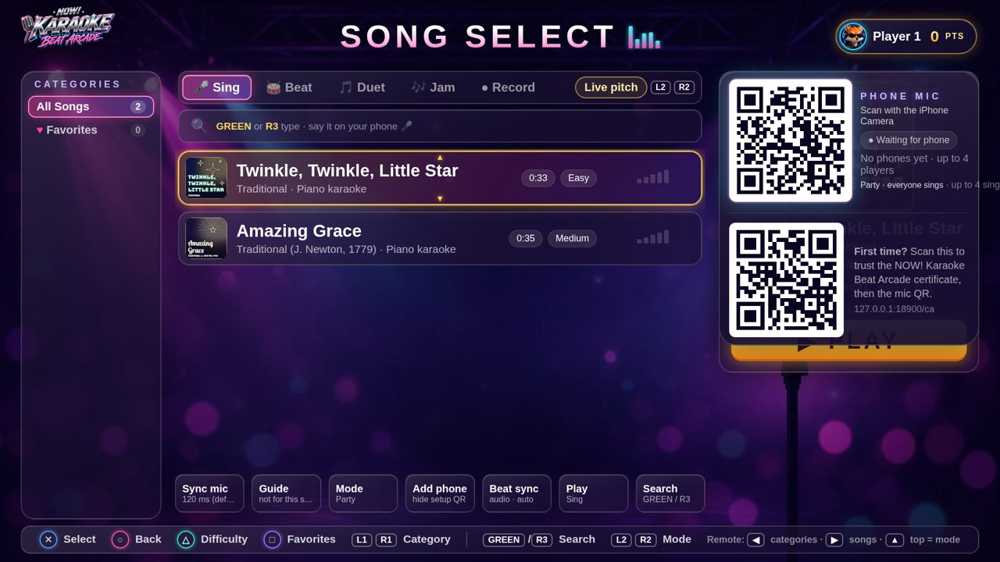

<p align="center"></p>

# Karaoke Beat Arcade (KBA)

Pitch-scored karaoke for a TV (a Samsung Tizen TV app, or any browser) where **phones are the microphones**. Up to four
singers join by scanning a QR code, sing into their phone, and get live pitch scoring on the big screen. Modes: **Sing**
(pitch scoring), **Beat** (rhythm game), **Duet**, **Jam** and **Record**. There is also a phone song queue/search, a global
leaderboard and online 1v1 matches on the optional hosted Worker.



> **No copyrighted songs are included.** The repo ships two self-made demos (public-domain melodies with an original
> synthesised piano backing) plus a few calibration beeps, so you can play immediately. You must only add music you own
> or have the rights to use. See [songs/README.md](songs/README.md).

Coding agents should start at [AGENTS.md](AGENTS.md) (Claude Code: [CLAUDE.md](CLAUDE.md)).

## What is in here

| Folder | What |
|---|---|
| `tv/` | The TV app (plain HTML/JS/CSS, Tizen widget or browser): menus, lyric lane, beat highway, scoring UI |
| `phone/` | Phone page: mic capture, on-phone pitch detection (YIN), song search/queue |
| `shared/` | Code used by both: scoring, pitch detection, autotune, search |
| `server/` | Node relay (`server/index.js`) that pairs one TV with up to four phones, serves the app and songs on your LAN, optional cloud bridge, optional Stingray adapter |
| `worker/` | Optional Cloudflare Worker: the same app hosted on the web, phone join via QR over real HTTPS, global leaderboard, online 1v1 |
| `tools/` | Song ingest, chart/beat analysis, packaging and install for Tizen, and many headless QA/perf scripts |
| `songs/`, `data/` | Your library (git-ignored except the demos) and library metadata |
| `docs/` | Scoring notes, Stingray notes |

```
 phone (HTTPS)                    local server (Node, server/index.js)               TV (Tizen widget or browser)
 mic -> YIN pitch (on phone) --wss--> pairing + relay (one TV, up to 4 phones) --ws--> audio, lyrics, pitch lane, scoring
```

## Quick start (browser, no TV or Cloudflare required)

Requires **Node 20+**. Python, ffmpeg and a signing certificate are not needed to play the demos.

```sh
npm install
npm run dev          # starts the local server; creates a throwaway cert if certs/ is empty
```

Open **http://127.0.0.1:8780/tv/** in a browser. You should see the two demo songs. Click a song, click **PLAY**, then
confirm once more to start without a phone mic (the first confirm warns that scoring needs a mic).

`npm start` is the same server without the dev banner. `KARAOKE_HOST` is the address phones use to reach this machine;
if unset it is auto-detected from the first LAN interface.

Phones need **HTTPS** they trust for the microphone. Install [mkcert](https://github.com/FiloSottile/mkcert) (`brew install mkcert`
on macOS, or see mkcert's install notes for Linux/Windows), then:

```sh
KARAOKE_HOST=<your LAN IP> npm run cert    # writes certs/ (git-ignored), copies the public rootCA.pem
```

Open `http://<your LAN IP>:8780/ca` on the phone and trust the profile (iOS: Settings → General → About →
Certificate Trust Settings). Or skip local certificates by using the hosted Worker below, which gives phones real HTTPS.

### Configuration (environment variables)

| Variable | Default | |
|---|---|---|
| `KARAOKE_HOST` | auto-detected LAN IP | Address used in the phone QR |
| `HTTP_PORT` / `HTTPS_PORT` | `8780` / `8743` | |
| `KARAOKE_CODE` | random, stored in `.local/pairing-code` | Pairing code in the QR |
| `KTV_CLOUD=0` | | Turn the cloud bridge off |
| `KTV_CLOUD_ORIGIN`, `KTV_CLOUD_ROOM` | from `.local/cloud-relay.json` | See "Cloud join" |
| `STINGRAY_API_KEY` | unset | Optional Stingray Karaoke API, see `docs/STINGRAY.md` |

## Samsung Tizen TV app

1. Install [Tizen Studio](https://developer.tizen.org/development/tizen-studio/download) (with the TV extensions) and
   create **your own** author certificate + distributor profile in Certificate Manager. Enable Developer Mode on the TV
   (Apps panel, type 12345, set the host IP to your computer) so `sdb` can connect.
2. Pick your own widget id: in `tv/config.xml` change `KaraokeBA1.KaraokeTV` / `KaraokeBA1` (a 10-character package id) if you like.
3. Create `.local/signing.json` (git-ignored):
   ```json
   { "sdk_path": "/path/to/tizen-studio", "profile": "<your profile name>", "app_id": "KaraokeBA1.KaraokeTV", "package_id": "KaraokeBA1" }
   ```
4. Build and install. `KARAOKE_SERVER` is the `host:port` of the machine running the server (it is baked into the packaged
   `config.js`), `TIZEN_TV_HOST` is the TV's IP:
   ```sh
   KARAOKE_SERVER=192.168.1.50:8780 npm run package        # -> dist/KaraokeTV.wgt (signed)
   TIZEN_TV_HOST=192.168.1.60 npm run tv:install
   TIZEN_TV_HOST=192.168.1.60 npm run tv:launch
   ```
   (Or put `{ "host": "<tv ip>", "server": "<host:port>" }` in `.local/device.json`.) The widget only bundles song
   metadata; audio streams from the server.

## Adding your songs

See [songs/README.md](songs/README.md) for the folder format and the ingest pipeline. Then `npm run index`. Nothing under
`songs/` except the demos should be committed. The automatic path needs **ffmpeg**, a Python venv, Demucs, faster-whisper
and librosa; the first install is heavy and a CPU vocal split can take several minutes per song. Use `--no-install` on
`npm run ingest` so it does not try to package or install a Tizen widget.

## Hosted web version (Cloudflare Worker, optional)

The Worker serves the same app under `/kba` on your own domain or `workers.dev`, lets phones join by scanning a QR code
over real HTTPS (no certificates), and adds the global leaderboard and online 1v1. It is protected by a numeric invite
code. Songs are uploaded as static assets, **so only deploy music you have the rights to host**.

Note: when nobody else is online, Quick Match (and an open challenge) may fall back to a simulated AI opponent after 8–15 seconds; those rounds never count on the leaderboards or online records (`GHOSTS_ENABLED`, see `worker/src/ghost.js`).

```sh
cd worker
npm install
cp wrangler.toml.example wrangler.toml     # set your account_id / route, review the feature flags
npx wrangler secret put INVITE_CODE        # digits only (up to 6): the code people type to get in
npx wrangler secret put SECRET             # long random string (signs cookies, admin endpoints)
npx wrangler secret put RELAY_TOKEN        # optional: lets your local server act as the room's TV
npm run build                              # assembles ./public from ../tv, ../phone, ../shared, ../songs + web patches
npm run deploy
```

Local dev: copy `.dev.vars.example` to `.dev.vars`, then `npm run dev`. Workers Static Assets and Durable Objects need a
Cloudflare account; heavy use of Durable Objects may need the Workers Paid plan.

### Cloud join (local server + hosted phone join)

To show a QR that works from any network, the local server can join the Worker's room as the TV. Create `.local/cloud-relay.json`
(git-ignored, mode 600):

```json
{ "origin": "https://your-worker.example.com", "base": "/kba", "inv": "<the RELAY_TOKEN secret>" }
```

Phones then scan `<origin>/kba/j/<room>`. If the Worker is unreachable the server falls back to the local QR.

## Development

```sh
npm run dev                # local server + browser URL (KTV_CLOUD=0)
npm test                   # node --test: scoring, pitch, server relay, queue, song files
npm run lint               # syntax check of the main entry points
npm run check:browser      # headless E2E with Playwright (npx playwright install chromium first)
```

`tools/` also has many `check-*.mjs`, `perf-*.mjs` and `shot*.mjs` scripts used during development. They drive the app with
Playwright and a synthetic microphone; some assume a larger library than the two demo songs and may need small tweaks.
See [AGENTS.md](AGENTS.md), [CONTRIBUTING.md](CONTRIBUTING.md) and `docs/SCORING.md`.

## License

[MIT](LICENSE). The demo songs are public-domain melodies and lyrics with arrangements generated by this project.
Third-party names (Samsung, Tizen, Stingray, Cloudflare) belong to their owners; this project is not affiliated with them.
